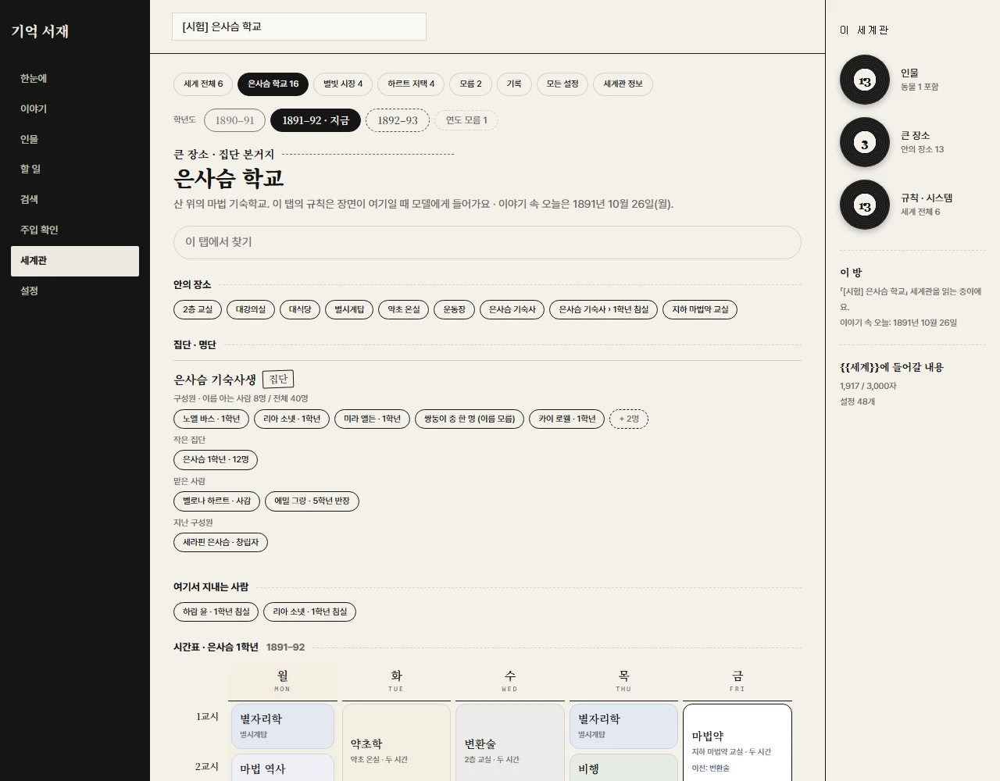

# 세계관 설정집 (Marinara World Archive)

> **베타 (v0.8.0-beta)**: 매일 쓰면서 다듬는 중이에요. 쓰기 전에 마리나라 데이터를 백업해 두세요. 문제가 있으면 이슈로 알려 주세요.

[Marinara Engine](https://github.com/Pasta-Devs/Marinara-Engine)용 확장이에요.

- **세계관을 자동으로 정리해요.** 롤플레이 대화를 읽어서 인물 · 장소 · 집단 · 규칙 · 시스템 · 일정을 근거 문장과 함께 정리해요. 사람이 쓴 칸은 덮어쓰지 않아요.
- **프롬프트에 넣어요.** 정리한 내용을 프리셋의 `{{세계}}` 자리에 넣어요. 지금 장면에 나온 것부터, 정해 둔 글자 수 안에서 넣어요.
- **기록에 남겨요.** 바뀐 것은 모두 「기록」에 남고, 하나씩 되돌릴 수 있어요.




## 설치

필요한 것은 Marinara Engine **2.5.1 · 2.5.2**예요. 다른 판에서는 맞지 않는 부분만 꺼지고 마리나라는 원래대로 켜져요.

### 1. 서버 모듈

**도커로 쓰는 경우**에는 서버 터미널에서 아래 명령을 실행하세요.

```sh
curl -fsSL https://raw.githubusercontent.com/tlsiddl/marinara-world-archive/main/install.sh | sh
```

- 마리나라 컨테이너를 찾아서 `docker-compose.override.yml`에 두 줄(폴더 연결, `NODE_OPTIONS`)을 넣고 다시 켜요. 마리나라 원래 파일은 건드리지 않아요.
- 한 서버에 마리나라 컨테이너가 둘 이상이면 아무것도 바꾸지 않고 멈춰요. 이때는 이름을 정해서 다시 실행하세요.

  ```sh
  curl -fsSL https://raw.githubusercontent.com/tlsiddl/marinara-world-archive/main/install.sh | MARINARA_CONTAINER=컨테이너이름 sh
  ```

- 기억 서재가 이미 깔려 있으면, 기억 서재가 만든 override 파일에 두 줄만 더해요. 둘 다 같이 켜져요.

**그냥 실행 · Termux**에서는 마리나라 폴더에서 같은 명령을 실행하세요. 앞으로는 `bash start-world-archive.sh`로 켜면 돼요. 같은 폴더에 기억 서재가 있으면 같이 켜져요.

### 2. 화면

마리나라의 **확장 관리자 → GitHub**에서 저장소 주소를 넣으세요.

```
https://github.com/tlsiddl/marinara-world-archive
```

찾은 파일 중 `extension/manifest.json`을 골라 설치하고 켜세요. 화면 오른쪽 아래의 **WORLD ARCHIVE** 티켓 버튼으로 열어요. 업데이트도 확장 관리자에서 해요. 화면과 서버의 판이 다르면 화면 맨 위에 알려 줘요. 그때는 서버에서 설치 명령을 다시 실행하세요.

### 3. 프리셋에 `{{세계}}` 넣기

프리셋의 시스템 쪽 섹션에 `{{세계}}`(또는 `{{world}}`)를 한 줄 넣으세요. 기억 서재를 쓰면 **`{{기억}}` 섹션 위에** 따로 두는 걸 권해요(고정 설정 → 겪은 일 순서).

삽화 에이전트를 쓰면 `{{세계외형}}`(`{{world_looks}}`)을 넣을 수 있어요. 장면에 나온 인물의 외형만 들어가요.

## 처음 쓰는 법

1. WORLD ARCHIVE를 열고 **새 세계관 만들기**를 눌러요.
2. 채팅방에서 그 세계관을 연결해요.
3. **세계관 정보**에서 자동 반영을 켜고, 읽을 때 쓸 마리나라 연결(모델)을 골라요.
4. 이미 대화가 쌓인 방이면 **「지난 대화도 읽기」**를 눌러요. 그냥 연결만 하면 그때부터 새로 오는 대화만 읽어요.
5. 다 읽으면 한 번씩 눌러 두세요(작은 호출이에요).
   - 「장소 위치 채우기」
   - 「규칙 적용되는 곳 채우기」
   - 「주제 채우기」
6. 「같은 것일 수 있음」 · 「서로 다른 말을 해요」 · 정리 후보는 사람이 골라요. 자동으로 합치거나 지우지 않아요.

이후로는 답이 올 때마다 아직 안 읽은 대화를 읽어요. 기본은 메시지 6개마다 읽고, 가장 최근 두 개는 리롤될 수 있어서 다음 차례에 읽어요.

## 기억 서재가 있을 때 / 없을 때

- **없을 때:** 혼자 다 돼요. 화면은 WORLD ARCHIVE 버튼으로 열어요.
- **있을 때:** [기억 서재](https://github.com/tlsiddl/marinara-memory-module) 안에 「세계관」 칸이 생겨서 거기서도 볼 수 있어요. 기억 서재는 겪은 일 · 감정 · 관계 변화를 맡고, 설정집은 오래가는 설정을 맡아요. 서로의 데이터를 고치지 않아요.
  - 기억 서재가 영어로 기억하는 방이면, 설정집도 그 방을 영어로 정리해요. 화면의 「보기: 한국어」로 한국어로 볼 수 있어요.

## 비용 (대략, 딥시크 계열 모델로 잰 값)

- **처음 읽기:** 메시지 50개짜리 방은 모델 호출 2번, 2만 5천~3만 1천 토큰이었어요. 메시지 하나에 약 500~600 토큰으로 보면 돼요.
- **평소:** 메시지 6개마다 한 번 읽어요. 한 번에 대략 5천~1만 5천 토큰이고, 세계관이 클수록 늘어요.
- **버튼:** 채우기 · 정리 버튼은 누를 때만, 작은 호출 1~3번이에요.
- **`{{세계}}`:** 프롬프트에 들어가는 글이에요. 기본 3,000자이고, 세계관 정보에서 바꿔요.

## 알려진 한계

- **학교 세계 쪽으로 다듬어졌어요.** 판타지 왕국 · 현대 도시 · 센티넬버스 · 헌터물(지어낸 시험 대화)로도 확인했지만, 가장 많이 고친 건 마법 학교 RP예요.
- **딥시크 계열 모델로만 시험했어요.** 다른 모델에서는 정리 품질이 다를 수 있어요.
- **같은 것 묶음은 사람이 골라요.** 같은 규칙이 규칙 · 시스템 두 곳에 들어가는 일이 남아 있어요.
- **내 캐릭터(페르소나)는 설정집에 안 들어가요.** 그래서 내 캐릭터의 등급 · 레벨 · 스킬도 따로 적히지 않아요.
- **장면 글자 수:** 장면에 인물 · 장소가 많으면 3,000자 안에서 규칙이 밀려날 수 있어요. 꼭 들어가야 할 규칙은 카드에서 「늘 먼저 넣기」를 켜거나, 글자 수를 늘려 주세요.
- **「적용되는 곳」:** 읽기만으로는 적게 채워져요. 「규칙 적용되는 곳 채우기」를 눌러 주세요.

## 되돌리기 · 끄기 · 데이터

- 이전 판으로 되돌리려면 설치 명령 끝의 `sh`를 `sh -s -- rollback`으로 바꿔 실행하세요.
- 끄려면 `sh -s -- uninstall`로 바꿔 실행하세요. **끈 뒤에는 프리셋의 `{{세계}}` · `{{세계외형}}`을 지워 주세요.** 끈 뒤에는 그 글자가 그대로 모델에 가요.
- 세계관 데이터는 마리나라 데이터 폴더의 `world-archive`에 있어요. 설치 · 업데이트 · 끄기로 지워지지 않아요. 지운 세계관은 `world-archive/trash/`에 사본이 남아요.
- 서버가 켜질 때 메모리에서만 두 곳(매크로 엔진, 서버 앱)에 끼어들어요. API는 마리나라 로그인 · 접속 제한을 그대로 따르고, 따로 토큰을 쓰지 않아요.

## 만드는 사람을 위해

```sh
npm test      # 단위 테스트 (Node 22.15+)
npm run check # 문법 검사
```

- [docs/셸-연동.md](docs/셸-연동.md): 다른 화면(셸)에서 설정집을 쓸 때의 API · 값 모양
- [docs/연동-계약.md](docs/연동-계약.md): 기억 서재 등 다른 모듈과의 약속
- [AGENTS.md](AGENTS.md): AI 개발 도구의 작업 규칙
- [docs/개발/](docs/개발/): 개발 기록(계획 · 진행 · 사령탑 대화). 처음 쓰는 사람은 안 봐도 돼요.
