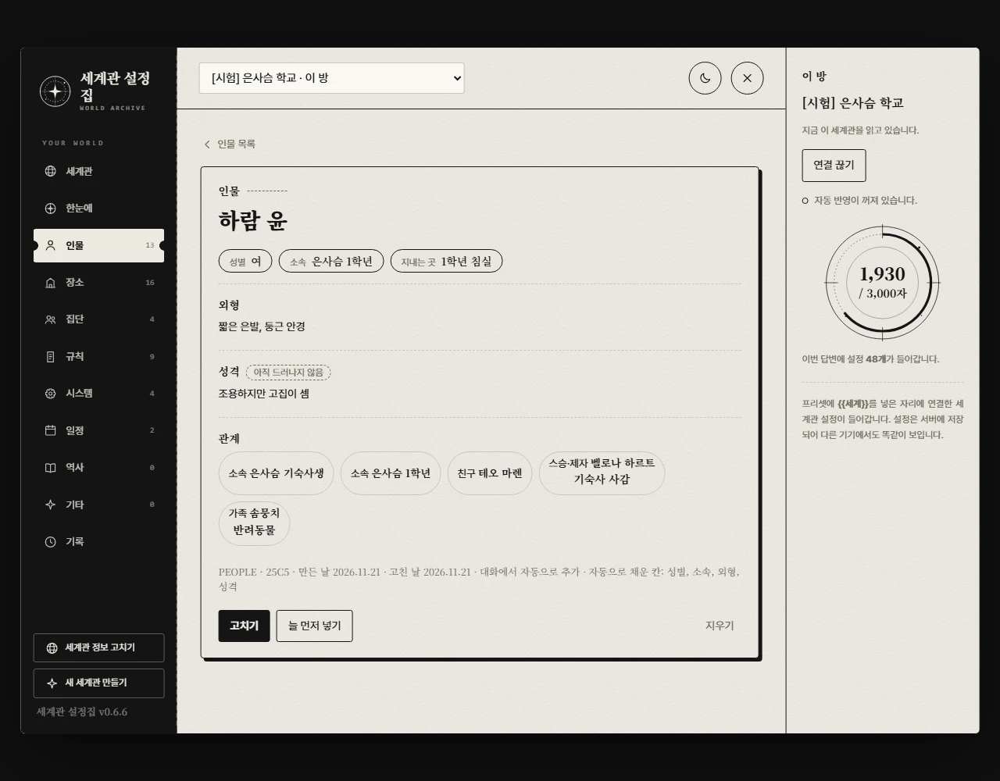

# 세계관 설정집 (Marinara World Archive)

> **베타 (v0.8.5-beta)**: 매일 쓰면서 다듬는 중이에요. 쓰기 전에 마리나라 데이터를 백업해 두세요. 문제가 있으면 이슈로 알려 주세요.

[Marinara Engine](https://github.com/Pasta-Devs/Marinara-Engine)용 확장이에요.

- **세계관을 자동으로 정리해요.** 롤플레이 대화를 읽어서 인물 · 장소 · 집단 · 규칙 · 시스템 · 일정을 근거 문장과 함께 정리해요. 사람이 쓴 칸은 덮어쓰지 않아요.
- **프롬프트에 넣어요.** 정리한 내용을 프리셋의 `{{세계}}` 자리에 넣어요. 정해 둔 글자 수 안에서 고정한 설정 → 지금 장면 인물 → 규칙 · 시스템(자리가 모자라면 짧은 모양으로) → 자세히 → 남는 자리에 나머지 순서로 넣어요.
- **기록에 남겨요.** 바뀐 것은 모두 「기록」에 남고, 하나씩 되돌릴 수 있어요.




## 준비물

1. **Marinara Engine 2.5.1 또는 2.5.2** — 도커 서버, 그냥 실행(Linux · macOS), 핸드폰(Termux), Windows(베타) 모두 돼요. 다른 판에서는 맞지 않는 부분만 꺼지고 마리나라는 원래대로 켜져요.
2. **Node.js 22.15 이상** — 도커 서버는 마리나라 이미지에 들어 있어서 따로 할 일이 없어요. 그냥 실행 · Termux · Windows는 `node -v`로 확인해 주세요(마리나라 자체가 Node 24 이상을 요구해서 보통은 이미 맞아요). 낮으면 설정집만 꺼지고 마리나라는 그대로 켜져요.
3. **정리에 쓸 모델 연결** — 마리나라에 저장된 연결 하나를 빌려 써요. 메시지 6개마다 부르니 **저렴하고 긴 글을 잘 읽는 모델**을 추천해요(예: DeepSeek 계열).
4. (선택) **[기억 서재](https://github.com/tlsiddl/marinara-memory-module)** — 있으면 기억 서재 안에 「세계관」 칸이 생기고 같이 켜져요. 없어도 혼자 다 돼요.

쓰기 전에 마리나라 데이터를 백업해 두세요.

## 설치

설치는 두 부분이에요. **① 서버에 설정집 모듈**, **② 마리나라에 화면(확장)**. 같은 명령을 다시 실행하면 업데이트가 돼요.

### 1. 서버 모듈

**도커 서버 (벌처 · AWS 등)** — 서버 터미널에서:

```sh
curl -fsSL https://raw.githubusercontent.com/tlsiddl/marinara-world-archive/main/install.sh | sh
```

- 켜져 있는 마리나라 컨테이너를 찾아요. 이름에 marinara가 들어간 프록시 · 봇 같은 다른 컨테이너가 있어도, 안에서 마리나라 서버(`packages/server/dist/index.js`)가 도는 컨테이너만 골라요.
- 찾으면 compose 파일에 두 줄(설정집 폴더 연결, `NODE_OPTIONS`)을 넣고 `docker compose up -d`로 다시 켜요. 마리나라 원래 파일은 건드리지 않아요.
  - 보통은 `docker-compose.override.yml`에 넣어요(없으면 만들어요).
  - 이미 `NODE_OPTIONS`를 쓰는 compose 파일이 있으면 그 파일의 줄 끝에 더해요. 다른 패치(기억 서재 등)는 그대로 남는지 넣기 전후로 확인하고, 하나라도 빠질 것 같으면 원래대로 돌리고 멈춰요.
  - 바꾸기 전 파일은 `.before-world-archive-날짜`로 남겨요. 파일 모양이 예상과 다르면 건드리지 않고, 직접 넣을 두 줄과 다시 켜는 명령을 알려 줘요.
  - 그 파일을 다른 도구가 통째로 바꾸면 설정집 줄이 빠질 수 있어요. 그러면 설치 명령을 다시 실행하면 돼요.
- 마리나라 서버가 여러 개거나 어느 것인지 확실하지 않으면 **아무것도 바꾸지 않고 멈춰요.** 그때는 컨테이너 이름을 정해 주세요(`docker ps`로 이름 확인):

  ```sh
  curl -fsSL https://raw.githubusercontent.com/tlsiddl/marinara-world-archive/main/install.sh | MARINARA_CONTAINER=컨테이너이름 sh
  ```

- compose를 `-f` 여러 개로 켜고 계셨다면, 설치기가 그 파일들을 같은 순서로 써서 다시 켜요. `docker-compose.override.yml`을 새로 더했다면 앞으로 직접 켤 때도 마지막에 `-f docker-compose.override.yml`을 붙여 주세요.
- 기억 서재가 이미 깔려 있으면 기억 서재가 만든 파일에 두 줄만 더해요. 기억 서재를 나중에 업데이트해도 그 줄은 남아서 둘 다 계속 켜져요.

**그냥 실행 (Linux · macOS)** — 마리나라 폴더에 들어가서 같은 명령을 실행해요.

```sh
cd ~/Marinara-Engine
curl -fsSL https://raw.githubusercontent.com/tlsiddl/marinara-world-archive/main/install.sh | sh
```

마리나라 폴더(`packages/server`가 들어 있는 폴더)는 지금 폴더, `~/Marinara-Engine`, `~/marinara-engine`, `~/Marinara` 순서로 찾아요. 다른 곳에 있으면 앞에 `MARINARA_DIR=/마리나라/폴더`를 붙여 주세요. 설치가 끝나면 앞으로는 `start.sh` 대신 이렇게 켜 주세요:

```sh
bash start-world-archive.sh
```

같은 폴더에 기억 서재가 깔려 있으면 이 파일 하나로 둘 다 켜져요(`start-memory.sh` 대신 써도 돼요).

**핸드폰 (Termux)** — 마리나라 폴더에서 같은 명령을 실행한 뒤 `bash start-world-archive.sh`로 켜 주세요. 안에서 `start-termux.sh`를 불러요.

**Windows (베타 — 아직 실제 Windows에서 확인 중이에요)** — PowerShell을 열고 아래 명령을 실행해 주세요. 어느 폴더에서 열어도 돼요.

```powershell
irm https://raw.githubusercontent.com/tlsiddl/marinara-world-archive/main/install.ps1 | iex
```

- **마리나라 폴더는 설치기가 찾아요.** 지금 폴더(마리나라 폴더나 그 안에서 열었으면 그 설치본을 먼저), 기본 설치 위치, 바탕화면 · 시작 메뉴의 Marinara 바로가기를 봐요.
- **못 찾으면** 폴더 선택 창이 열려요. `start.bat`과 `packages` 폴더가 들어 있는 마리나라 폴더를 골라 주세요. 선택 창을 쓸 수 없으면 터미널에 경로를 붙여 넣어도 돼요(따옴표 포함 가능, Enter만 누르면 아무것도 안 바꾸고 취소).
- **마리나라가 여러 개 설치돼 있으면** 번호로 골라요.
- 경로를 직접 정하려면 설치 명령 앞에 이렇게 붙여 주세요: `$env:MARINARA_DIR = 'D:\Marinara-Engine'; irm … | iex`

설치가 끝나면 바탕화면에 생긴 **Marinara + 세계관 설정집** 바로가기(또는 `start-world-archive.bat`)로 켜 주세요. 같은 폴더에 기억 서재가 깔려 있으면 이 파일 하나로 **둘 다** 켜져요(`start-memory.bat`으로 켜면 설정집 없이 기억 서재만 켜져요). `start.bat`이나 MarinaraLauncher로 켜면 설정집 없이 켜져요.

**설치 확인** — 마리나라 로그(도커는 `docker logs 컨테이너이름`)에 아래 줄들이 보이면 성공이에요. `v` 뒤는 판 번호예요.

```
[world-archive] v0.8.5-beta applied: {{세계}} · {{세계외형}} macro
[world-archive] v0.8.5-beta applied: API at /api/world-archive
[world-archive] v0.8.5-beta hook registered (no Marinara files changed)
```

`fail closed (…): this Marinara version does not match`가 보이면 그 판의 마리나라와 맞지 않아서 그 부분만 꺼진 거예요. 마리나라는 그대로 쓰실 수 있어요.

### 2. 화면 (확장)

마리나라의 **개인 확장 관리 → GitHub로 가져오기**에서:

- 저장소 주소: `https://github.com/tlsiddl/marinara-world-archive`
- 파일: `extension/manifest.json`

설치하고 켜면 화면 오른쪽 아래에 **WORLD ARCHIVE** 티켓 버튼이 생겨요. 버튼은 끌어서 옮길 수 있고, [확장 서랍](https://github.com/boricha417/marinara-extension-drawer)을 쓰시면 서랍 안에 담겨요. 기억 서재 0.37 이상이 있으면 기억 서재 안 「세계관」 칸에서도 같은 화면이 열려요.

화면과 서버의 판이 다르면 화면 맨 위에 알려 줘요. 그때는 서버에서 설치 명령을 다시 실행하세요.

### 3. 프리셋에 `{{세계}}` 넣기

쓰는 프롬프트 프리셋에 새 섹션(역할: 시스템)을 하나 만들고 내용에 `{{세계}}`(또는 `{{world}}`)를 적어요. **이걸 빠뜨리면 설정이 정리돼도 답변에 들어가지 않아요.**

기억 서재를 쓰면 `{{기억}}` 섹션 **바로 위**에 두는 걸 권해요(고정 설정 → 겪은 일 순서).

| 순서 | 섹션 | 내용 |
| --- | --- | --- |
| … | 페르소나 (마커) | |
| | **세계관** (새로 만든 섹션, 시스템) | `{{세계}}` |
| | 기억 (기억 서재를 쓰면) | `{{기억}}` |
| | 채팅 기록 (마커) | |

섹션을 따로 두면 마리나라의 **프롬프트 구성** 보기에서 설정이 실제로 들어갔는지, 몇 토큰인지 바로 볼 수 있어요.

삽화 에이전트를 쓰면 연결된 세계관의 인물 외형을 삽화 요청에 자동으로 넣어요. 시공간 카드가 있으면 그 카드에 나온 인물을 우선하고, 카드가 없으면 현재 답에서 이름이 나온 인물을 찾아요. 이름이 언급됐더라도 실제 장면에 없는 경우가 있으니 결과를 확인해 주세요. 머리색·눈색·피부색은 인물별로 구분하며, 이미지 외형에 이미 지정한 값이 있으면 그것을 우선해요. 추가 모델 호출은 없어요. 셸이 함께 설치되어 외형을 주입하는 경우에는 셸 쪽을 사용해요.

자동 주입은 설정집에 저장된 외형과 NPC 프로필을 쓰며, 셸의 선택형 마법 세계 백과는 설정집에 포함되지 않아요. `{{세계외형}}`(`{{world_looks}}`) 매크로를 직접 프롬프트에 넣는 방식도 계속 쓸 수 있어요.

**NPC 생성 지침이 있는 프리셋이라면** — 답변 끝에 새 NPC의 `<npc_profile>` 블록을 쓰게 하는 섹션은 켜 두세요. 설정집이 그 블록을 읽어서 나이 · 외형을 본문보다 훨씬 잘 채워요. 외형 줄을 `- Appearance and clothing (hair colour and eye colour first):`로 바꾸면 머리색 · 눈색 칸도 채워져요. 이미 있는 NPC를 고쳐 쓰게 하는 업데이트 블록(`<npc_update>` 같은 것)은 빼도 돼요 — 설정집은 바뀐 내용을 본문에서 읽어요.

## 처음 쓰는 법

1. WORLD ARCHIVE를 열고 **새 세계관 만들기**를 눌러요. 만들기 창에서 **정리할 모델(마리나라 연결)**을 고르고 「자동 반영 켜기」를 그대로 두세요(연결이 하나뿐이면 미리 골라져 있어요).
2. 채팅방에서 그 세계관을 연결해요.
3. 만들 때 모델을 안 골랐으면 화면 맨 위에 노란 띠 「정리할 모델을 아직 안 골랐어요」가 떠요. **[고르기]**를 누르면 **세계관 정보**의 자동 반영 칸으로 가요. 이 모델은 **기억 서재가 쓰는 모델과 따로**예요. 같은 걸 골라도 돼요.
   - 기억 서재 안 「세계관」 칸에서는 가로 캡슐 줄 맨 끝 **「세계관 정보」**에 있어요.
4. 이미 대화가 쌓인 방이면 **「지난 대화도 읽기」**를 눌러요. 그냥 연결만 하면 그때부터 새로 오는 대화만 읽어요.
5. 다 읽으면 한 번씩 눌러 두세요(작은 호출이에요).
   - 「장소 위치 채우기」
   - 「규칙 적용되는 곳 채우기」
   - 「주제 채우기」
6. 「같은 것일 수 있음」 · 「서로 다른 말을 해요」 · 정리 후보는 사람이 골라요. 자동으로 합치거나 지우지 않아요.

이후로는 답이 올 때마다 아직 안 읽은 대화를 읽어요. 기본은 메시지 6개마다 읽고, 가장 최근 두 개는 리롤될 수 있어서 다음 차례에 읽어요.

## 기억 서재가 있을 때 / 없을 때

- **없을 때:** 혼자 다 돼요. 화면은 WORLD ARCHIVE 버튼으로 열어요.
- **있을 때:** [기억 서재](https://github.com/tlsiddl/marinara-memory-module) 안에 「세계관」 칸이 생겨서 거기서도 볼 수 있어요. 기억 서재는 겪은 일 · 감정 · 관계 변화를 맡고, 설정집은 오래가는 설정을 맡아요. 서로의 데이터를 고치지 않아요.
  - 기억 서재가 영어로 기억하는 방이면, 설정집도 그 방을 영어로 정리해요. 화면의 「보기: 한국어」로 한국어로 볼 수 있어요.

## 자주 묻는 질문

- **기억 서재랑 같이 쓰면 세계관 정리 모델도 기억 서재 모델과 같나요?** 아니요, 따로예요. 세계관마다 「세계관 정보」 → 「자동 반영」 칸의 「정리할 모델(마리나라 연결)」에서 골라요. 같은 모델을 골라도 돼요. 기억 서재 안 「세계관」 칸에서는 가로 캡슐 줄 맨 끝 「세계관 정보」에 있고, 아직 안 골랐으면 맨 위 노란 띠의 [고르기]로 바로 갈 수 있어요.

## 비용 (대략, 딥시크 계열 모델로 잰 값)

- **처음 읽기:** 메시지 50개짜리 방은 모델 호출 2번, 2만 5천~3만 1천 토큰이었어요. 메시지 하나에 약 500~600 토큰으로 보면 돼요.
- **평소:** 메시지 6개마다 한 번 읽어요. 한 번에 대략 5천~1만 5천 토큰이고, 세계관이 클수록 늘어요.
- **버튼:** 채우기 · 정리 버튼은 누를 때만, 작은 호출 1~3번이에요.
- **`{{세계}}`:** 프롬프트에 들어가는 글이에요. 기본 3,000자이고, 세계관 정보에서 바꿔요.

### 추천 글자 수 (v0.8.2)

세계관 정보의 글자 수 단추에 정리 언어에 맞는 단 하나가 **「추천」**으로 보여요. 기본값은 그대로 3,000자예요(자동으로 바꾸지 않아요).

| 정리 언어 | 추천 | 설정이 많으면 |
|---|---|---|
| 한국어 | 3,000자 (≈ 1,200토큰) | 5,000자 |
| 영어 | 6,000자 (≈ 1,600토큰) | 8,000자 |

영어는 같은 내용이 글자로 약 2배 길어요. 「한눈에 → 이번 답변에 들어갈 내용」에 규칙 · 시스템이 글자 수 때문에 빠졌으면 「규칙 · 시스템 N개가 글자 수 때문에 빠졌어요 — 추천 ○○자」가 떠요.

잰 값(2026-11-22, 모델 호출 없이 `{{세계}}`를 만들어 셈, 토큰은 마리나라 토큰 세기). 「규칙이 다 들어가는 가장 작은 단」은 3,000 · 5,000 · 6,000 · 8,000 · 12,000 가운데예요.

| 시험 세계관 | 정리 언어 | 장면 방식: 다 넣으면 필요한 글자 → 가장 작은 단 | 전부 넣기: 필요한 글자 → 가장 작은 단 |
|---|---|---|---|
| 헌터물(지어낸, 50메시지) | 한국어 | 2,648자 → **3,000** | 3,296자 → 5,000 |
| 센티넬버스(지어낸, 50메시지) | 한국어 | 3,297자 → **5,000** | 3,766자 → 5,000 |
| 현대 도시(지어낸, 50메시지) | 영어 | 4,702자 → **5,000** | 5,845자 → 6,000 |
| 판타지 왕국(지어낸, 50메시지) | 영어 | 5,878자 → **6,000** | 7,769자 → 8,000 |
| 긴 RP 방 복사본 둘(메시지 126개 이상) | 영어 | 약 1만 8천 · 3만 자 → 12,000으로도 안 됨 | 약 3만 1천 · 5만 3천 자 → 안 됨 |

**v0.8.3부터** 넣는 순서가 바뀌었어요: 고정 → 지금 장면 인물(자리가 모자라면 짧은 모양 — 이름 · 성별 · 나이 · 머리색 · 눈색 · 소속 · 지금 상태 한 줄) → 규칙 · 시스템(짧은 모양, 적어도 한도의 1/5) → 장면 인물 자세히 → 이곳 · 최근 언급 규칙 자세히 → 나머지 규칙 짧게 → 남는 자리에 장면 밖 인물 · 장소 → 나머지. 그래서 작은 글자 수에서도 장면 인물이 빠지지 않고 규칙도 들어가요.

**큰 세계관(오래 읽은 방)** — 「장면 인물은 모두 자세히 · 이곳 · 최근 규칙은 모두 자세히 · 세계 규칙은 모두 적어도 짧게」가 다 되는 글자 수(2026-11-22, 실제 RP 방 복사본 · 실서버 세계관을 읽기만 해서 잼):

| 세계관 | 장면 방식 | 전부 넣기 |
|---|---|---|
| 뉴해포(설정 약 150개) | 20,000자 (≈ 5,300토큰) | 20,000자 |
| 해리포터(설정 약 250개) | 30,000자 (≈ 7,900토큰) | 20,000자 · 모든 규칙은 25,000자 (≈ 6,500토큰) |

큰 세계관은 20,000~30,000자를 권해요(최대 40,000자). 그보다 작게 쓰면 장면 인물 · 규칙이 짧은 모양으로 들어가요. 꼭 자세히 들어가야 할 것은 카드에서 「늘 먼저 넣기」를 켜 주세요.

## 알려진 한계

- **학교 세계 쪽으로 다듬어졌어요.** 판타지 왕국 · 현대 도시 · 센티넬버스 · 헌터물(지어낸 시험 대화)로도 확인했지만, 가장 많이 고친 건 마법 학교 RP예요.
- **딥시크 계열 모델로만 시험했어요.** 다른 모델에서는 정리 품질이 다를 수 있어요.
- **같은 것 묶음은 사람이 골라요.** 같은 규칙이 규칙 · 시스템 두 곳에 들어가는 일이 남아 있어요.
- **내 캐릭터(페르소나)는 설정집에 안 들어가요.** 그래서 내 캐릭터의 등급 · 레벨 · 스킬도 따로 적히지 않아요.
- **장면 글자 수:** 장면에 인물 · 장소가 많으면 3,000자 안에서 규칙이 밀려날 수 있어요. 꼭 들어가야 할 규칙은 카드에서 「늘 먼저 넣기」를 켜거나, 글자 수를 늘려 주세요.
- **「적용되는 곳」:** 읽기만으로는 적게 채워져요. 「규칙 적용되는 곳 채우기」를 눌러 주세요.

## 업데이트

설치할 때와 **같은 명령**을 다시 실행하고, 확장 관리에서 화면도 업데이트해 주세요. 세계관 데이터는 지워지지 않아요.

업데이트는 새 파일을 모두 `world-archive/.incoming`에 받아 확인한 뒤에 한꺼번에 바꿔요. 중간에 받기가 실패하면 기존 판이 그대로 남고, 바꾸기 전 판은 `world-archive/.prev`에 보관돼요. 모든 파일을 같은 커밋에서 받아서 두 판이 섞이지 않아요.

**이전 판으로 되돌리기** — 업데이트 뒤 문제가 생기면:

```sh
curl -fsSL https://raw.githubusercontent.com/tlsiddl/marinara-world-archive/main/install.sh | sh -s -- rollback
```

도커는 마리나라를 다시 켜 줘요. 그냥 실행 · Termux는 마리나라를 껐다가 `bash start-world-archive.sh`로 다시 켜 주세요.

Windows(PowerShell):

```powershell
$env:WORLD_ARCHIVE_ACTION='rollback'; irm https://raw.githubusercontent.com/tlsiddl/marinara-world-archive/main/install.ps1 | iex
```

마리나라를 껐다가 `start-world-archive.bat`으로 다시 켜 주세요.

## 끄기 · 지우기

- **방 하나만 끄기**: 그 채팅방에서 세계관 연결을 끊거나, 세계관 정보에서 자동 반영을 꺼요.
- **모듈 끄기**:

  ```sh
  curl -fsSL https://raw.githubusercontent.com/tlsiddl/marinara-world-archive/main/install.sh | sh -s -- uninstall
  ```

  도커는 compose 파일에서 설정집 두 줄만 빼고(다른 패치는 그대로인지 확인) 다시 켜요. 바꾸기 전 파일은 `.before-world-archive-removal-날짜`로 남겨요. 그냥 실행 · Termux는 `start-world-archive.sh` 대신 원래 `start.sh`(기억 서재를 쓰면 `start-memory.sh`)로 켜면 꺼져요. Windows는 아래 명령으로 `start-world-archive.bat`과 바탕화면 바로가기를 지우고, 앞으로 `start.bat`(기억 서재를 쓰면 `start-memory.bat`)으로 켜면 돼요.

  ```powershell
  $env:WORLD_ARCHIVE_ACTION='uninstall'; irm https://raw.githubusercontent.com/tlsiddl/marinara-world-archive/main/install.ps1 | iex
  ```
- **끈 뒤에는 프리셋의 `{{세계}}` · `{{세계외형}}`을 지워 주세요.** 끈 뒤에는 그 글자가 그대로 모델에 가요.
- **완전히 지우기**: 위처럼 끈 뒤 마리나라 폴더의 `world-archive` 폴더와 데이터 폴더의 `world-archive` 폴더를 지워요. 데이터 폴더 쪽을 지우면 세계관이 모두 사라지니, 먼저 세계관 정보에서 백업을 내려받아 두세요.

## 데이터와 보안

- 세계관 데이터는 마리나라 데이터 폴더의 `world-archive`에 있어요. 설치 · 업데이트 · 끄기로 지워지지 않아요. 지운 세계관은 `world-archive/trash/`에 사본이 남아요. 세계관 정보에서 백업을 내려받고 복원할 수 있어요.
- 대화는 세계관 정보에서 고른 연결로만 보내요. 다른 곳으로는 보내지 않아요.
- 서버가 켜질 때 메모리에서만 두 곳(매크로 엔진, 서버 앱)에 끼어들어요. API(`/api/world-archive`)는 마리나라 로그인 · 접속 제한을 그대로 따르고, 따로 토큰을 쓰지 않아요.

## 만드는 사람을 위해

```sh
npm test      # 단위 테스트 (Node 22.15+)
npm run check # 문법 검사
```

- [docs/셸-연동.md](docs/셸-연동.md): 다른 화면(셸)에서 설정집을 쓸 때의 API · 값 모양
- [docs/연동-계약.md](docs/연동-계약.md): 기억 서재 등 다른 모듈과의 약속
- [AGENTS.md](AGENTS.md): AI 개발 도구의 작업 규칙
- [docs/개발/](docs/개발/): 개발 기록(계획 · 진행 · 사령탑 대화). 처음 쓰는 사람은 안 봐도 돼요.
